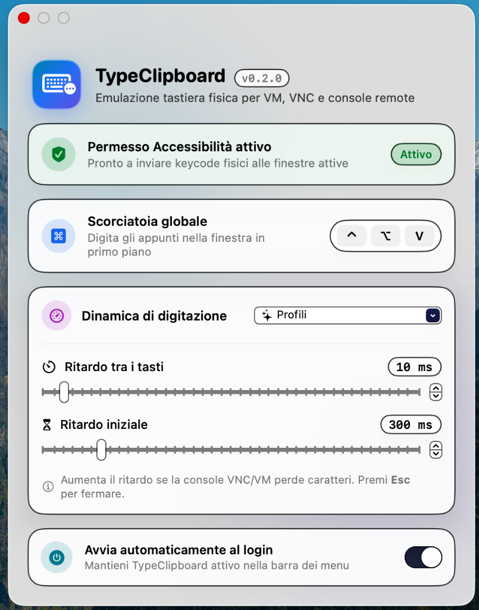

<p align="right">
  <strong>🇬🇧 English</strong> · <a href="README.it.md">🇮🇹 Italiano</a>
</p>

# TypeClipboard ⌨️📋

**Paste by typing.** A lightweight macOS menu bar app that types your clipboard contents character by character, emulating a physical keyboard.

Built for every scenario where standard `⌘V` paste doesn't work:

- VM web consoles (vSphere, Proxmox, Hyper-V, iDRAC/iLO, noVNC…)
- TeamViewer, VNC, and other remote desktop sessions
- Windows login screens over console
- Input fields that block clipboard paste

It is the native macOS equivalent of this classic AutoHotkey script:

```autohotkey
^!v::
{
SendInput "{Raw}" A_Clipboard
}
```

<p align="center">
  
</p>

## Features

- 🎯 **Customizable global shortcut** – defaults to **⌃⌥V**
- 🔤 **Real physical keycodes** – translates each character into the corresponding physical keystroke of the active keyboard layout (with real `Shift`/`Option` key-down/up events), so remote consoles that ignore Unicode strings work reliably
- 🌐 **Unicode fallback** for characters not present on the active layout (emojis, etc.)
- ↩️ Converts newlines to `Return` and tabs to `Tab`
- 🐢 **Adjustable keystroke delay** + quick presets (*Fast*, *Balanced*, *Slow remote console*)
- ⏱️ **Initial delay** + automatic wait for shortcut modifier release before typing starts
- ⛔ Press **Esc** at any time to abort typing
- 🪟 **Native Liquid Glass UI** designed for macOS Tahoe (with automatic translucent fallback on macOS 13–15)
- 🚀 Launch at login
- 🫥 Lives purely in the menu bar (no Dock icon)

## Requirements

- macOS 13 Ventura or later (Apple Silicon or Intel)
- To build from source: Xcode or Command Line Tools (`xcode-select --install`)

## Installation

### From Releases

1. Download `TypeClipboard-x.y.z.zip` from the [Releases](https://github.com/mantovanellimatteo/typeclipboard/releases) page.
2. Extract and move `TypeClipboard.app` to `/Applications`.
3. Because the app is ad-hoc signed (not notarized), right-click → **Open** on first launch, or run:
   ```bash
   xattr -dr com.apple.quarantine /Applications/TypeClipboard.app
   ```

### From Source

```bash
git clone https://github.com/mantovanellimatteo/typeclipboard.git
cd typeclipboard
./build.sh
cp -R build/TypeClipboard.app /Applications/
open /Applications/TypeClipboard.app
```

## First Launch: Accessibility Permission

To synthesize keyboard events, macOS requires **Accessibility** permission:

**System Settings → Privacy & Security → Accessibility → enable TypeClipboard**

The app's Settings window displays live permission status and includes a button to open the pane directly.

> [!NOTE]
> With ad-hoc signing, macOS may treat the app as a new binary after rebuilding.
> If typing stops working after an update, remove TypeClipboard from the Accessibility list and add it back.

## Usage

1. Copy any text (`⌘C`).
2. Focus the target window (VM console, TeamViewer, etc.).
3. Press **⌃⌥V** and release the modifier keys: the clipboard text will be typed out.
4. Press **Esc** to stop typing mid-stream.

From the ⌨️ menu bar icon → **Impostazioni…** you can configure:

| Option | Default | Description |
|---|---|---|
| Global shortcut | `⌃⌥V` | Click the keycap pill and press a new key combination (requires at least `⌘`, `⌃`, or `⌥`) |
| Keystroke delay | `10 ms` | Increase if a slow remote console drops characters |
| Initial delay | `300 ms` | Delay before typing begins |
| Launch at login | `off` | Automatically start TypeClipboard when you log in |

## Known Limitations

- The keyboard layout on the remote machine should match your Mac's active layout.
- Characters that require dead keys on the active layout (e.g., `~` on some layouts) fall back to Unicode input, which some remote consoles may ignore.

## Project Structure

```
Sources/TypeClipboard/
├── App.swift                  # entry point, menu bar & permissions
├── HotKeyManager.swift        # global hotkey registration (Carbon)
├── KeyboardLayoutMapper.swift # character → physical keycode mapper (UCKeyTranslate)
├── Typer.swift                # CGEvent keystroke synthesizer
└── SettingsView.swift         # Liquid Glass settings UI & shortcut recorder
Resources/Info.plist
build.sh                       # release build + .app bundle + zip archive
VERSION                        # single source of truth for version (SemVer)
CHANGELOG.md
```

## Versioning

This project follows [Semantic Versioning](https://semver.org/). To cut a new release:

1. Update `VERSION` and `CHANGELOG.md`.
2. `git commit -am "Release vX.Y.Z" && git tag vX.Y.Z && git push --follow-tags`
3. Run `./build.sh` and attach `build/TypeClipboard-X.Y.Z.zip` to the GitHub Release.

## License

MIT – see [LICENSE](LICENSE).
